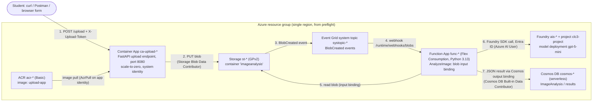
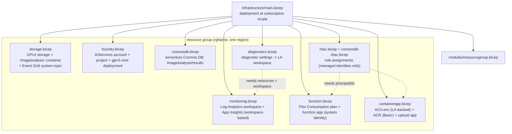
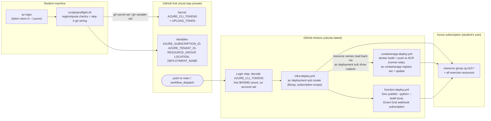
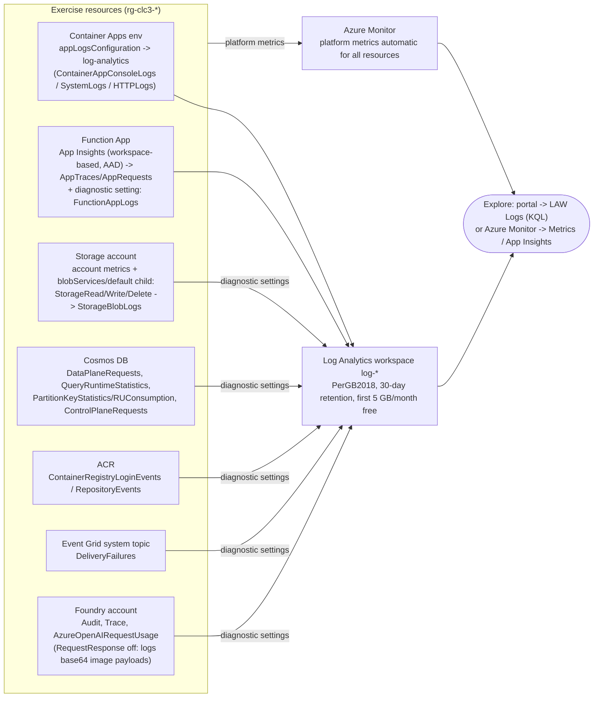

# Student Guide — Self-Paced Walkthrough in 3 Phases (uap-clc3-2026)

**Format:** ~3 hours, self-paced during the practical session (the lecturer is present for questions).
You deploy the reference architecture step by step in your own Azure for Students subscription and
your own private fork, practicing the lecture concepts.

**Diagrams:** rendered inline below and at each phase (raw sources: [architecture](diagrams/architecture.mermaid) · [infrastructure](diagrams/infrastructure.mermaid) · [CI/CD](diagrams/cicd.mermaid) · [observability](diagrams/observability.mermaid)) — see **Architecture overview**.

## Concepts covered (learning objectives → phase)

| # | Concept | Phase |
|---|---|---|
| 1 | Deployment methods in Azure (Portal / CLI / Bicep / CI) | 1, 2, 3 |
| 2 | IaC with Bicep — structure, params, modules, dynamic values, resource chaining | 1 |
| 3 | Core Azure services configured via the Azure Portal | 1, 3 |
| 4 | CI/CD — getting code into Azure services | 2 |
| 5 | Azure Foundry — models, versions, inputs/outputs, usage | 2, 3 |
| 6 | Observability — logs, errors, service communication, metrics | 3 |

## Ground rules

1. Fork stays **private** (the `AZURE_CLI_TOKENS` secret carries your subscription credentials).
2. Run `scripts/preflight.sh` first; use its `RECOMMENDED LOCATION` everywhere (single region).
3. Set a budget alert before deploying (Phase 1, step 5).
4. Phases build on each other — do them in order.
5. Cleanup is mandatory at the end (Phase 3, step 5).
6. If anything fails or looks unexpected: see the last section, **Troubleshooting and known issues**.

---

# Architecture overview

## Scenario / use case

You build a small **image-analysis pipeline**: a student uploads a photo (e.g. `test.jpeg`) to a
web app, the image lands in blob storage, an event notifies a serverless function, the function asks
a **Foundry vision-language model** (`gpt-5-mini`) to describe the image, and the resulting JSON is
stored in Cosmos DB — all deployed from your private GitHub fork, observable in one Log Analytics
workspace, and cheap (the only fixed cost is ACR Basic at ~$0.17/day; everything else is free at this
scale on Azure for Students).

## Target architecture

The request flow end to end (numbers = call order):



## Services involved and their role

| Service | Resource (name pattern) | Role in the pipeline |
|---|---|---|
| **Container Apps** | app `ca-upload-*` in env `cae-*` | Public HTTPS upload endpoint `POST /upload` (token-protected), scale-to-zero; writes the uploaded file to storage |
| **Azure Container Registry** | `acr-*` (Basic SKU) | Stores the `upload-app` Docker image; the app pulls it via its system identity (AcrPull) |
| **Storage (GPv2)** | `st-*`, container `imageanalysis` | Landing zone for uploaded images; emits `BlobCreated` events |
| **Event Grid** (system topic) | `systopic-*` | Routes `BlobCreated` events to the function's blob webhook |
| **Function App** (Flex Consumption, Python 3.13) | `func-*` | `AnalyzeImage` (blob trigger): reads the blob, calls the model via the Foundry SDK with managed identity, writes the result via Cosmos output binding |
| **Azure AI Foundry** | account `ais-*`, project `clc3-project`, deployment `gpt-5-mini` | Vision-language model (version `2025-08-07`, `GlobalStandard`) that returns the image analysis as JSON |
| **Cosmos DB** (serverless) | `cosmos-*`, db `ImageAnalysis`, container `results` (pk `/filename`) | Stores one analysis document per image (`id` = file name) |
| **Log Analytics + App Insights** | `log-*`, `appi-*` | Central logs/metrics/traces for all resources (Phase 3) |
| **GitHub** (your private fork + Actions) | fork of this repo | Source code and the three CI/CD workflows that deploy infra, function and container app with your az CLI token |

All Azure resources live in **one resource group in one region** (the `RECOMMENDED LOCATION` from
preflight), deployed by a single subscription-scope Bicep deployment. Access between services is
**identity-based (RBAC), no keys** — except the LAW workspace and Cosmos keep local auth enabled so
the Portal (Data Explorer, workspace shared key) works for you.

---

# Phase 1 — Foundation: IaC (Bicep) + Portal exploration (~60 min)

**Concepts:** 1, 2, 3. **Deliverable:** infrastructure deployed once via Bicep/CLI; every resource opened and understood in the Portal.

**Phase 1 diagram — what the Bicep deployment creates** (raw: [infrastructure.mermaid](diagrams/infrastructure.mermaid)):



## Exact steps

1. **Fork & clone** ([README step 1](../README.md#1-fork-and-clone)): fork `juergenbr/uap-clc3-2026` on GitHub (keep it **private**), clone it, `cd uap-clc3-2026`.
2. **Dev container** ([README step 2](../README.md#2-open-in-the-dev-container)): VS Code → command palette → *Dev Containers: Reopen in Container* (Docker must run). The image has Python 3.13, az CLI, Functions Core Tools, Bicep, jq, gh.
3. **Logins:**
   ```bash
   az login                                   # browser/device-code
   az account set --subscription <your-student-sub-id>
   gh auth login                              # once; needed by preflight step 6
   ```
4. **Preflight** ([README step 3](../README.md#3-step-0--pre-flight-checks-mandatory-do-this-first)):
   ```bash
   bash scripts/preflight.sh
   ```
   Note the printed `RECOMMENDED LOCATION` (call it `$LOC`) and the candidate-region list. If a check can't run automatically, the script prints the equivalent manual step — see **Troubleshooting** below.
5. **Budget alert (free)** — Portal → Cost Management → Budgets → Add, or:
   ```bash
   SUB=$(az account show --query id -o tsv)
   az rest --method PUT \
     --url "https://management.azure.com/subscriptions/$SUB/providers/Microsoft.Consumption/budgets/clc3-budget?api-version=2023-11-01" \
     --body "{\"properties\":{\"category\":\"cost\",\"amount\":40,\"timeGrain\":\"monthly\",\"timePeriod\":{\"startDate\":\"$(date +%Y-%m-01)\",\"endDate\":\"$(date -v+1y +%Y-%m-%d 2>/dev/null || date -d '+1 year' +%Y-%m-%d)\"},\"notifications\":{\"Alert80\":{\"enabled\":true,\"operator\":\"GreaterThan\",\"threshold\":80,\"contactEmails\":[\"<you@students.fhooe.at>\"]}}}}"
   ```
6. **Responsible AI terms** (once per subscription, [README step 3](../README.md#3-step-0--pre-flight-checks-mandatory-do-this-first)): Portal → Create a resource → *Cognitive Services* → tick *Responsible AI terms* → create in West Europe → delete the resource group again.
7. **Read the IaC before deploying** (15 min): open `infrastructure/main.bicep` and skim `infrastructure/modules/*.bicep`. Identify: params (`rgName`, `location`, `uploadToken`, model params), `var nameSuffix = take(uniqueString(subscription().subscriptionId, rgName), 16)`, the module blocks, module outputs feeding other modules' params, `dependsOn`. See [infrastructure diagram](diagrams/infrastructure.mermaid).
8. **Deploy via CLI + Bicep** ([README step 4](../README.md#4-deploy-the-infrastructure)). From the repo root, using the **`UPLOAD_TOKEN` printed by preflight step 6**:
   ```bash
   az deployment sub create --name clc3-2026 --location $LOC \
     --template-file infrastructure/main.bicep \
     --parameters rgName=rg-clc3-<your-lastname> location=$LOC uploadToken=$UPLOAD_TOKEN
   ```
   **Save the printed outputs** (`functionAppName`, `uploadAppFqdn`, `acrName`, `acrLoginServer`, `containerAppName`, `storageAccountName`, `cosmosAccountEndpoint`, `foundryProjectEndpoint`, …) — steps in later phases use them.
9. **Watch the deployment in the Portal**: subscription → **Deployments** → `clc3-2026` → operations/resources/outputs.
10. **Explore every resource in the Portal** (RG → Overview → click each):
    - Storage `st*`: Data storage → Containers → `imageanalysis`; note the Event Grid **system topic** `systopic-*`; Access control (IAM) → role assignments.
    - Foundry `ais-*` → project `clc3-project` → **Model catalog / Deployments**: `gpt-5-mini`, version `2025-08-07`, SKU `GlobalStandard`, capacity. Endpoint + keys blade (note: RBAC, not keys).
    - Cosmos `cosmos-*`: Data Explorer → `ImageAnalysis` / `results` → partition key `/filename`; Settings → serverless.
    - Container Apps env `cae-*` + app `ca-upload-*`: note the placeholder image and ingress FQDN (the revision becomes healthy only in Phase 2).
    - Function app `func-*` + plan `asp-*`: Overview → Flex Consumption; Configuration → app settings (identity-based connections, `APPLICATIONINSIGHTS_CONNECTION_STRING` with AAD).
    - ACR `acr*`: Repositories (empty until Phase 2); Access control → AcrPull assignment.
    - LAW `log-*` + App Insights `appi-*`: retention 30 days; workspace-based App Insights.

## Questions to answer (Phase 1)

1. Name the deployment methods available in Azure and state which one you used in step 8 and why it fits IaC.
2. What does `take(uniqueString(subscription().subscriptionId, rgName), 16)` guarantee, and why is the length capped at 16 for storage/ACR/Cosmos names?
3. Trace one example of resource chaining: how does `function.bicep` learn the storage account name? (`storage.outputs.*` → module params)
4. What is the purpose of `dependsOn` in `main.bicep`, and which dependency is implicit via outputs?
5. In the Portal, where do you see which role assignments exist, and which built-in roles are used? (Storage Blob Data Contributor/Owner, AcrPull, Foundry User, …)
6. Which resource in the RG currently costs a fixed daily amount, and how much? (ACR Basic, $0.17/day)
7. Why is the container app revision not healthy yet at this point? What fixes it in Phase 2?

---

# Phase 2 — Ship it: CI/CD + Foundry model (~60 min)

**Concepts:** 4, 5, 1. **Deliverable:** function + container app deployed via the GitHub Actions workflows; Foundry model inspected in the portal. (The manual commands in the blue info boxes are **optional** — they show the same deployments without CI.)

**Phase 2 diagram — how your fork gets wired and how the CI workflows deploy** (raw: [cicd.mermaid](diagrams/cicd.mermaid)):



## Exact steps

1. **Wire the fork for CI**: re-run `bash scripts/preflight.sh` (step 6 pushes the repo secret + variables via `gh`). Verify: your fork → Settings → Secrets and variables → Actions.
2. **Trigger CI** — no code change needed; use the **Run workflow** button for each workflow on `main`:
   repo → **Actions** → select the workflow → **Run workflow** dropdown → Branch: `main` → **Run workflow**.
   Do this for `infra-deploy`, then `containerapp-deploy`, then `function-deploy` — and **wait for each run to finish** before starting the next (and before the manual steps below). While they run, read the three workflow files in `.github/workflows/`.
   (Alternative trigger: push a change to `main` — e.g. add a `// ci trigger` comment line to `infrastructure/main.bicep` and push. `infra-deploy` fires on `infrastructure/**` changes, `containerapp-deploy` on `src/upload-app/**`, `function-deploy` on `src/image-analysis-function/**`.)

   **You already deployed the infrastructure manually in Phase 1 — that is fine, do not delete anything:** the CI `infra-deploy` run is an *incremental* update of the same subscription-level deployment (same template, same parameters), so it creates **no new resources** — it just re-applies the existing ones. It also re-applies the same `UPLOAD_TOKEN` (the preflight secret you used in Phase 1), so your saved token keeps working, and if an app image was already pushed to your ACR it keeps that image instead of resetting the container app to the placeholder.

   After `containerapp-deploy` and `function-deploy` succeed, the function (`AnalyzeImage`) and the upload app are live — **steps 3–5 below are optional manual equivalents**, shown so you can see and compare what the workflows do.

3. > [!NOTE]
   > **Optional — manual function deploy** (not required: the `function-deploy` workflow already published the function). Run this to see the same deployment done from your machine without CI ([README step 5](../README.md#5-deploy-the-function-flex-consumption--python)):
   >
   > ```bash
   > cd src/image-analysis-function
   > pip install -r requirements.txt
   > rm -rf .python_packages
   > PIP_PLATFORM=manylinux2014_x86_64 PIP_PYTHON_VERSION=3.13 PIP_ABI=cp313 PIP_ONLY_BINARY=:all: \
   >   func azure functionapp publish <functionAppName> --build local
   > ```
   >
   > (On Linux/Windows the `PIP_*` env vars and `rm -rf` are harmless no-ops in effect — the command works everywhere.)
   > Verify: the `func` output lists `AnalyzeImage - [blobTrigger]`; Portal → function app → **Functions** → `AnalyzeImage` present (trigger: Blob, enabled).

4. > [!NOTE]
   > **Optional — manual Event Grid subscription** (not required: `function-deploy` already creates/updates it). Needed only if you published the function purely by hand (step 3) and no CI run did it — the webhook endpoint is validated against the published function, so this must come after a publish:
   >
   > ```bash
   > SUB=$(az account show --query id -o tsv); RG=rg-clc3-<your-lastname>
   > APP=<functionAppName>; ST=<storageAccountName>
   > HOST=$(az functionapp show --name "$APP" --resource-group "$RG" --query properties.defaultHostName -o tsv)
   > BLOBS_KEY=$(az rest --method POST --url "https://management.azure.com/subscriptions/$SUB/resourceGroups/$RG/providers/Microsoft.Web/sites/$APP/host/default/listkeys?api-version=2024-11-01" --query systemKeys.blobs_extension -o tsv)
   > az eventgrid event-subscription create \
   >   --source-resource-id "/subscriptions/$SUB/resourceGroups/$RG/providers/Microsoft.Storage/storageAccounts/$ST" \
   >   --name "sub-$APP-AnalyzeImage" --endpoint-type webhook \
   >   --endpoint "https://$HOST/runtime/webhooks/blobs?functionName=Host.Functions.AnalyzeImage&code=$BLOBS_KEY" \
   >   --included-event-types Microsoft.Storage.BlobCreated \
   >   --subject-begins-with "/blobServices/default/containers/imageanalysis/blobs/"
   > ```

5. > [!NOTE]
   > **Optional — manual container app deploy** (not required: the `containerapp-deploy` workflow already built the image on the runner, pushed it to your ACR, ran `registry set`, and updated the app). Run this to see the runner-side build done locally on your machine ([README step 6](../README.md#6-deploy-the-upload-container-app)):
   >
   > ```bash
   > ACR=<acrName>; SERVER=<acrLoginServer>
   > TOKEN=$(az acr login --name "$ACR" --expose-token --query accessToken -o tsv)
   > echo "$TOKEN" | docker login "$SERVER" -u 00000000-0000-0000-0000-000000000000 --password-stdin
   > docker build --platform linux/amd64 -t "$SERVER/upload-app:latest" -f src/upload-app/Dockerfile src/upload-app
   > docker push "$SERVER/upload-app:latest"
   > az containerapp registry set --name <containerAppName> --resource-group $RG --server "$SERVER" --identity system
   > az containerapp update --name <containerAppName> --resource-group $RG --image "$SERVER/upload-app:latest"
   > ```

6. **Foundry in the Portal** (ai.azure.com): project `clc3-project` → **Playground** → send `test.jpeg`, inspect the request/response JSON (inputs/outputs); **Model catalog** → deployed model: name, version `2025-08-07`, SKU, capacity, TPM quota; **Monitoring**: requests, latency, tokens.

## Questions to answer (Phase 2)

1. Why does the CI build the image on the runner (`docker build`) instead of `az acr build`? Which SKU would ACR Tasks need?
2. How does the GitHub runner authenticate to Azure without a service principal? What exactly is in the `AZURE_CLI_TOKENS` secret, and why must the fork be private?
3. How does the runner authenticate to ACR for `docker push`? (`az acr login --expose-token`)
4. Why must `az containerapp registry set --identity system` run before the first ACR-image update, and why is the registry entry not in the Bicep template?
5. Why is the Event Grid subscription created only *after* `func publish`? What endpoint does it use and which system key authenticates it?
6. Why does Flex Consumption need `--build local`? What breaks on macOS without the `PIP_*` env vars?
7. Which model version is deployed and why not `gpt-4o-mini`? Where do you check deprecations?
8. In the workflows, where do `ACR_NAME`/`FUNCTION_APP_NAME`/etc. come from, and why not repo variables set by CI?

---

# Phase 3 — Operate it: e2e test, observability, cost, cleanup (~60 min)

**Concepts:** 6, 3, 5. **Deliverable:** one successful upload → analysis → Cosmos document, all hops traced in logs/metrics; deliberate error found; costs understood; everything deleted.

**Phase 3 diagram — where logs and metrics of every resource go** (raw: [observability.mermaid](diagrams/observability.mermaid)):



## Exact steps

1. **E2E upload** ([README step 7](../README.md#7-test-end-to-end)):
   ```bash
   curl -H "X-Upload-Token: $UPLOAD_TOKEN" -F "file=@test.jpeg" https://<uploadAppFqdn>/upload
   # expect HTTP 200 + JSON {blobName, container, size, message}
   curl -H "X-Upload-Token: wrong-token" -F "file=@test.jpeg" https://<uploadAppFqdn>/upload
   # expect HTTP 401  (deliberate error for step 3)
   ```
   If the first call unexpectedly returns 401, read the current token back and retry:
   ```bash
   az containerapp secret show --name <containerAppName> --resource-group <rg> --secret-name upload-token --query value -o tsv
   ```
2. **Trace every hop in the Log Analytics workspace** (see [observability diagram](diagrams/observability.mermaid)); Portal → LAW `log-*` → **Logs**, using the KQL snippets from [README step 7 → "Explore observability"](../README.md#explore-observability-azure-monitor--log-analytics):
   - Container app: `ContainerAppConsoleLogs_CL | where ContainerAppName_s contains "ca-upload"` → the `/upload` **200 and 401**.
   - Function: `AppTraces | where Message contains "AnalyzeImage"` → `New blob detected(EventGrid)` + `Executed 'Functions.AnalyzeImage' (Succeeded)` + duration.
   - Storage: `StorageBlobLogs | where OperationName has "PutBlob"` → `test.jpeg` written.
   - Foundry model usage: `AzureMetrics | where ResourceProvider =~ "MICROSOFT.COGNITIVESERVICES" and MetricName in ("AzureOpenAIRequests","InputTokens","OutputTokens","TotalTokens","Latency")`; same data in the portal ai.azure.com → project → **Monitoring**.
   - Cosmos: `AzureDiagnostics | where ResourceProvider == "MICROSOFT.DOCUMENTDB" and Category == "DataPlaneRequests"`; and Portal → Cosmos → Data Explorer → `ImageAnalysis/results` → document `id=test.jpeg` with the `analysis` JSON.
   - Metrics: any resource → **Monitor → Metrics** (function executions, ACA requests/CPU, Cosmos RU/s); the same data is in the LAW as `AzureMetrics`.
3. **Deliberate-error exercise:** using the wrong-token 401 from step 1, find the failure in logs/metrics within 5 minutes and explain the service-communication chain (who called whom, in which order, with which result code).
4. **Cost check:** Portal → subscription → **Cost analysis**, grouped by resource: ACR Basic is the only fixed cost ($0.17/day); everything else is free at this scale (LAW 5 GB/month free, Cosmos serverless, Flex free grant, scale-to-zero ACA, model ~$0.002/image). Compare with your budget alert.
5. **Cleanup (mandatory, [README step 11](../README.md#11-cleanup-do-this-when-you-are-done)):**
   ```bash
   az group delete --name rg-clc3-<your-lastname> --yes --no-wait
   # after it finishes, purge the soft-deleted Cognitive Services account so names can be reused:
   az cognitiveservices account purge --name <ais-...> --location $LOC -g rg-clc3-<your-lastname>
   az group list   # verify empty
   ```

## Questions to answer (Phase 3)

1. Trace one uploaded image through all services using only logs/metrics — which table/query shows which hop?
2. Where do you see that Event Grid delivered the BlobCreated event successfully?
3. How many tokens did your inference consume, and where is that visible (two places)?
4. What did the wrong-token request look like in the container app logs (status code, path, timestamp)?
5. Which diagnostic-setting categories are enabled for storage vs. Cosmos vs. Foundry, and why is Foundry `RequestResponse` off? (cost: base64 image payloads)
6. Why do platform metrics need no diagnostic setting, and what is the difference between Azure Monitor Metrics and the `AzureMetrics` table in the LAW?
7. What is the only fixed daily cost in this architecture, and how would you verify it in Cost analysis?
8. Why must the Cognitive Services account be purged after `az group delete` before re-deploying with the same names?

---

# Appendix A — Answer key (for the lecturer)

- **P1-Q1:** Portal, Cloud Shell, CLI/PowerShell, ARM/Bicep, REST, SDKs, CI (GitHub Actions) — step 8 used CLI+Bicep (ARM engine), which is repeatable/scriptable vs. Portal clicks.
- **P1-Q2:** deterministic per (subscription, rgName) → no collisions between students in different subscriptions; 16 hex chars because storage/ACR/Cosmos names have length limits and need lowercase alphanumerics.
- **P1-Q3:** `storage.outputs.storageAccountName` passed as `storageAccountName` param to the `functionApp` module — outputs of one module become inputs of another (chaining); `dependsOn` is for ordering without data flow (e.g. rbac needs the RG).
- **P1-Q5:** RG → Access control (IAM) → Role assignments; roles: Storage Blob Data Owner/Contributor, AcrPull, Foundry User, Monitoring Metrics Publisher, Cosmos DB Built-in Data Contributor — all to managed-identity principals, no keys. (CLI: assignments live on the individual resources, not the RG — `az role assignment list --resource-group` alone shows only RG-scope ones.)
- **P1-Q6:** ACR Basic $0.1666/day; everything else is consumption/free-tier at this scale.
- **P1-Q7:** placeholder MCR image revision until the real ACR image is pushed in Phase 2.
- **P2-Q1:** `TasksOperationsNotAllowed` on student subs; ACR Tasks need Standard/Premium. Runner-side build + `az acr login --expose-token` works on Basic.
- **P2-Q2:** base64 tar of `~/.azure` token store (msal_token_cache.json + azureProfile.json); workflows decode it into `$HOME/.azure` on the runner and run `az account set`. Public fork → anyone with write access can read secrets via a workflow.
- **P2-Q4:** the platform mints an ACR pull token at first revision provisioning; AcrPull is only assigned by rbac.bicep *after* the containerapp module — declaring the registry in Bicep deadlocks. CI adds it via `registry set` once AcrPull exists.
- **P2-Q5:** the blob-extension webhook endpoint is validated against the published function; key = `blobs_extension` system key from `listkeys`.
- **P2-Q6:** Flex has no remote/Oryx build; `--build local` runs pip on the host — on macOS without the `PIP_PLATFORM=manylinux2014_x86_64 PIP_PYTHON_VERSION=3.13 PIP_ABI=cp313 PIP_ONLY_BINARY=:all:` env vars (after `rm -rf .python_packages`) it packages macOS wheels → Linux host fails with `invalid ELF header` (cryptography `_rust.abi3.so`), 0 functions loaded.
- **P2-Q7:** gpt-5-mini (2025-08-07); gpt-4o-mini (2024-07-18) is deprecating and rejected for new deployments (validation.md).
- **P2-Q8:** `az deployment sub show --name clc3-2026 --query properties.outputs` — GITHUB_TOKEN couldn't be granted write on repo variables reliably on fresh forks (403, validation.md C2).
- **P3-Q1:** ContainerAppConsoleLogs_CL (200/401, field `Log_s`) → StorageBlobLogs PutBlob (`Uri`, `StatusCode`) → EG delivery seen via AppTraces "New blob detected(EventGrid)" → AppTraces "Executed 'Functions.AnalyzeImage' (Succeeded)" → model usage via `AzureMetrics` (COG provider) + Foundry portal Monitoring → DOCUMENTDB DataPlaneRequests + Data Explorer doc.
- **P3-Q3:** `AzureMetrics` with `ResourceProvider =~ "MICROSOFT.COGNITIVESERVICES"` (AzureOpenAIRequests/TotalTokens/Latency) + Foundry portal Monitoring.
- **P3-Q5:** storage blob child StorageRead/Write/Delete→StorageBlobLogs; Cosmos DataPlaneRequests et al. (`statusCode_s`, `requestCharge_s`); Foundry account Audit/Trace/AzureOpenAIRequestUsage + AllMetrics, project Audit/Trace + AllMetrics — RequestResponse off: logs full payloads incl. base64 image (~1.4× upload size).
- **P3-Q6:** platform metrics are emitted to Azure Monitor automatically (Metrics explorer, free); `AllMetrics` diagnostic settings copy them into `AzureMetrics` in the LAW.
- **P3-Q7:** ACR Basic only; Cost analysis grouped by resource/resource group.
- **P3-Q8:** soft-delete keeps the name reserved (`FlagMustBeSetForRestore` on recreate); purge removes it.

# Appendix B — Quick reference

- Preflight: `bash scripts/preflight.sh` (manual fallback: `scripts/README.md`)
- Infra deploy: [README step 4](../README.md#4-deploy-the-infrastructure) · Function: [step 5](../README.md#5-deploy-the-function-flex-consumption--python) · Container app: [step 6](../README.md#6-deploy-the-upload-container-app) · E2E: [step 7](../README.md#7-test-end-to-end) · Cleanup: [step 11](../README.md#11-cleanup-do-this-when-you-are-done)
- Workflows: `.github/workflows/{infra-deploy,containerapp-deploy,function-deploy}.yml`
- KQL snippets: [README step 7 → "Explore observability"](../README.md#explore-observability-azure-monitor--log-analytics) · Full pitfall list: `docs/validation.md`

---

# Troubleshooting and known issues

Start here if a step fails or behaves unexpectedly. The authoritative, live-verified pitfall list
(symptom → fix) is **[docs/validation.md](validation.md)** — entries E1–E22 and C1–C3, plus
[README step 10 "Troubleshooting"](../README.md#10-troubleshooting) and the manual preflight fallback
[`scripts/README.md`](../scripts/README.md).

The issues students hit most often in the dry run:

| Symptom | Solution | Details |
|---|---|---|
| Deployment fails on **role assignments** (`RoleAssignmentExists` / AAD propagation) | Re-run the **identical** `az deployment sub create` command — propagation usually completes on retry | [README step 4](../README.md#4-deploy-the-infrastructure), validation.md |
| Deployment fails **midway** (e.g. `AKSCapacityHeavyUsage` on the Container Apps env) | `az group delete --name <rg> --yes`, then re-run with a **fresh rgName + new deployment name** (`--name clc3-2026-r2`) in the next candidate region from preflight | [README step 4](../README.md#4-deploy-the-infrastructure), validation.md |
| Upload returns **401** although you used the preflight token (a CI `infra-deploy` run rotated it to the `UPLOAD_TOKEN` secret) | Read the current token and retry: `az containerapp secret show --name <containerAppName> --resource-group <rg> --secret-name upload-token --query value -o tsv` | validation.md E14 |
| Function app shows **0 functions** / `invalid ELF header` after publish on macOS | Use the exact command in Phase 2 step 3 (`rm -rf .python_packages` + `PIP_PLATFORM=manylinux2014_x86_64 PIP_PYTHON_VERSION=3.13 PIP_ABI=cp313 PIP_ONLY_BINARY=:all:`), then confirm `1 functions loaded` in `AppTraces` | validation.md E15 |
| `az containerapp update --image <acr>…` fails (no registry credentials) on a manual deploy | Run `az containerapp registry set --name <containerAppName> --resource-group <rg> --server <acrLoginServer> --identity system` first, then `update` (Phase 2 step 5) | validation.md C1/E16 |
| Manual `func publish` while the CI `function-deploy` run is in flight → `409 DeploymentConflictException` | Wait for the workflow run to finish, then re-run your manual publish (or vice versa) | validation.md E19 |
| KQL error **SEM0100** on `StorageBlobLogs` | The columns are `Uri`, `StatusCode`, `CallerIpAddress` — **not** `Uri_s`/`StatusCode_d`/`CallerIpAddress_s` | validation.md E17 |
| Event Grid query returns **nothing on success** | Expected: the system topic logs only `DeliveryFailures`. A successful delivery is visible via `AppTraces \| where Message contains "New blob detected(EventGrid)"` | validation.md E18 |
| Foundry token usage missing in `AzureDiagnostics` | Expected for project-endpoint calls: use the `AzureMetrics` query in Phase 3 step 2 (`ResourceProvider =~ "MICROSOFT.COGNITIVESERVICES"`) or ai.azure.com → project → **Monitoring** | validation.md E18/E22 |
| Cost analysis shows **$0** for a fresh resource group | Cost data lags ~24 h — switch Cost analysis to the **last 7 days**, or check again tomorrow | validation.md E20 |
| `az consumption budget create` rejects `--notifications` / requires `--category`/`--end-date` (newer az CLI) | Use the `az rest` command in Phase 1 step 5, or Portal → Cost Management → Budgets → Add | validation.md E13 |
| A **preflight** check can't run automatically | The script prints the equivalent manual step (Portal/CLI); authoritative list: [`scripts/README.md`](../scripts/README.md) | `scripts/README.md` |
| Anything else | [README step 10 "Troubleshooting"](../README.md#10-troubleshooting) → [docs/validation.md](validation.md) (E1–E22, C1–C3) → ask the lecturer | — |
